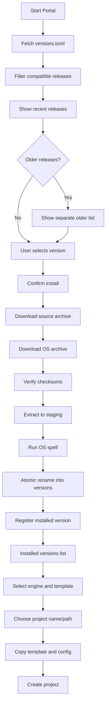
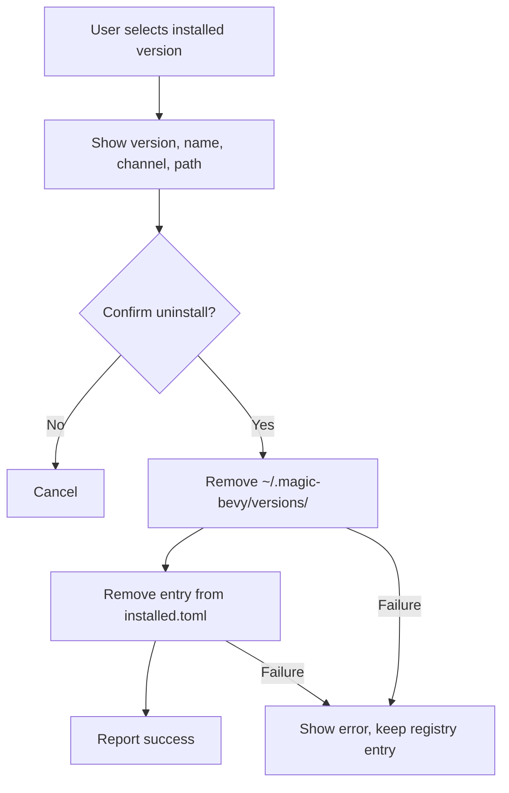

# Architecture

## Current Structure

```text
magic-portal/
  Cargo.toml
  Cargo.lock
  README.md
  LICENSE
  .gitignore
  agent-docs/
  src/
    main.rs
    cli.rs
    theme.rs
    core/
      mod.rs
      error.rs
      paths.rs
      version.rs
      github.rs
      installer.rs
      templates.rs
      project.rs
      run.rs
      doctor.rs
      progress.rs
    platform/
      mod.rs
      linux.rs
      macos.rs
      windows.rs
```

`src/main.rs` dispatches to `cli::run()`. The GUI (`app.rs`) is not implemented yet.

## Target Structure

Keep UI-independent logic separate from the UI so it can be tested without a window.

```text
src/
  main.rs
  app.rs
  cli.rs
  core/
    mod.rs
    error.rs
    paths.rs
    version.rs
    github.rs
    installer.rs
    templates.rs
    project.rs
    run.rs
    doctor.rs
    progress.rs
  platform/
    mod.rs
    linux.rs
    macos.rs
    windows.rs
```

### Modules

| Module | Responsibility |
|---|---|
| `main.rs` | Entry point. Start UI or CLI. |
| `app.rs` | UI state, screens, progress, confirmation dialogs. Not implemented yet. |
| `cli.rs` | Clap commands, JSON envelope, headless execution, confirmations. |
| `core::error` | Shared error type and JSON error kinds. |
| `core::paths` | Resolve `~/.magic-bevy`, cache, versions, installed registry. |
| `core::version` | Parse `versions.toml` and `magic.toml`, filter compatible releases, sort versions. |
| `core::github` | Fetch manifests, resolve release assets, download files, verify checksums. |
| `core::installer` | Download, verify, extract zip/tar.gz, run spells, register version, uninstall. |
| `core::templates` | Discover templates, read `template.toml`, locate icons. |
| `core::project` | Validate project name/destination, copy the engine version (excluding executable, `portal/`, `.github/`), overlay template, write project `magic.toml`. |
| `core::run` | Resolve a project's engine and launch it with the project as cwd. |
| `core::doctor` | Check root, registry, version directories, spells, cargo config, templates. |
| `core::progress` | Progress events, reporter trait, cancellation flag. |
| `platform::*` | OS detection, archive extensions, spell paths and arguments, cargo config paths. |

## Rules

- `core` must not depend on the UI or CLI.
- GUI and CLI share the same `core` functions.
- Every GUI action must have a CLI equivalent.
- UI runs on the main thread; downloads and installations run in worker threads.
- Progress is sent through the `Reporter` trait; the CLI prints to stderr.
- Every long operation has a cancel path (`CancelFlag`).
- Every destructive operation uses staging and atomic rename.
- Archives are extracted to staging first. Zip and tar.gz entries are validated against path traversal.
- Remote asset names are validated before they are joined to a local path.
- Error messages must be user-readable and actionable.

## Data Flow



## Uninstall Flow



Uninstall must not touch:

- `~/.magic-bevy/packages/`
- `~/.magic-bevy/layouts/`
- Other installed versions
- User projects

## Installed Version Registry

Use `~/.magic-bevy/installed.toml` as the source of truth for installed versions.

```toml
[[versions]]
version = "0.1.0"
name = "nova"
path = "versions/0.1.0"
installed_at = "2026-01-01T00:00:00Z"
```

Do not infer installed versions by scanning directories only. The registry records what the portal installed and whether the install completed.

## Dependency Guidance

Preferred dependencies:

- `serde` + `toml` for manifests
- `ureq` for HTTP
- `zip`, `tar`, and `flate2` for archives
- `sha2` for checksum verification
- `semver` for version sorting
- `ctrlc` for CLI cancellation
- `eframe` + `egui` if the GUI uses the same stack as Magic Bevy
- `thiserror` for error types
- `dirs` for home directory resolution
- `clap` 4.5 for CLI
- `serde_json` for `--json` output

Do not add a large framework without telling the user first. Keep the dependency list small.

## Security

- Use HTTPS only.
- Only follow redirects to GitHub hosts.
- Verify checksums when provided.
- Do not execute downloaded scripts without showing them to the user and asking for confirmation.
- Do not run `cargo` to build the engine during install.
- Do not extract archives outside the target version directory.
- Reject archive entries that escape the destination, including tar entries with `..` or absolute paths.
- Validate remote asset names before joining them to a local path.
- Do not create projects inside the protected engine data directories.
- Do not store GitHub tokens in the repository.